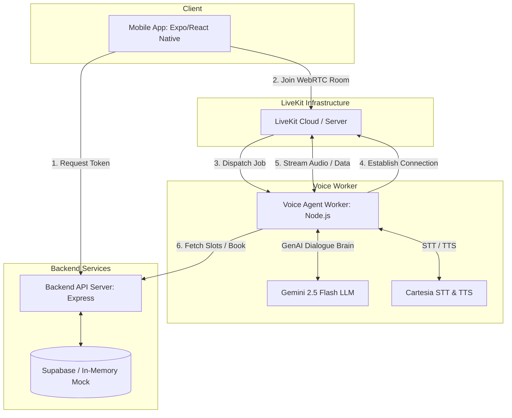

# Hospital Voice Agent System (Voice Agents Beta)

Welcome to the **Hospital Voice Agent Monorepo**, a state-of-the-art, bilingual (Bangla & English) real-time voice appointment scheduling system. This repository features an AI receptionist named **Sristi** who assists patients in booking clinical specialists via a natural, spoken interface.

---

## 📖 What This Repo Does

This repository houses a fully integrated monorepo designed to automate patient scheduling using voice-based conversational AI. 
* **Bilingual Interaction:** The system handles speech in Bengali (including Bangladeshi regional accents), English, and fluid "Banglish" (code-switching) natively.
* **Specialist Matching:** Maps patient symptoms to appropriate medical specialties (e.g., Chiropractor, Physiotherapist, Massage Therapist, Sports Rehab, General Consultant).
* **Real-time Scheduling:** Integrates with a scheduling backend that enforces double-booking prevention using database transactions.
* **Fallback Simulation:** The system includes a simulated/mock call engine so developers can test the full voice conversational flow without configuring LiveKit cloud accounts or API keys.

---

## 🏗️ Architecture Overview

The codebase is organized as an npm workspace monorepo. Here is a high-level view of how the system components interact:



### Component Breakdown

1. **`packages/types`** ([types](file:///Users/minhazulabedin/Projects/hospital-voice-agent-monorepo-/packages/types/src/index.ts))
   * Shared TypeScript definitions for domain entities (`Specialist`, `AvailabilitySlot`, `Booking`) and request/response payloads, ensuring static type-safety across client, backend, and agent.
2. **`apps/mobile`** ([mobile](file:///Users/minhazulabedin/Projects/hospital-voice-agent-monorepo-/apps/mobile/App.tsx))
   * A React Native / Expo application implementing the patient portal.
   * Connects to WebRTC rooms using `@livekit/react-native` and displays real-time audio visualizers (pulsing rings, animated waveforms), speaker/mute controls, call timer, and live transcriptions.
3. **`apps/backend`** ([backend](file:///Users/minhazulabedin/Projects/hospital-voice-agent-monorepo-/apps/backend/src/server.ts))
   * An Express server interfacing with Supabase. Generates WebRTC tokens for callers and exposes JSON endpoints for slot availability query and transaction-safe booking updates.
4. **`apps/agent`** ([agent](file:///Users/minhazulabedin/Projects/hospital-voice-agent-monorepo-/apps/agent/src/agent.ts))
   * A Node.js worker powered by `@livekit/agents` that responds to room connection requests. Orchestrates LLM, STT, and TTS engines and registers custom tool calls for medical booking flows.

---

## 🔄 Session Lifecycle & Vendor-Switching

### 1. Session Lifecycle Flow

The lifecycle of a single voice agent session moves through the following stages:

```mermaid
sequenceDiagram
    autonumber
    actor Caller as Patient (Mobile App)
    participant Backend as Backend Server
    participant LK as LiveKit Server
    participant Worker as Agent Worker (Sristi)

    Caller->>Backend: POST /api/token (Request participant credentials)
    Backend-->>Caller: JSON (Token, unique roomName, wss URL)
    
    rect rgb(30, 41, 59)
        Note over Caller, LK: Audio Initialization & Connection
        Caller->>Caller: Configure Native Audio (Speaker Mode)
        Caller->>LK: Connect to Room (WebRTC Signalling)
    end
    
    LK->>Worker: Job Dispatch Alert (New room created)
    Worker->>LK: Connect to Room (Join as Agent participant)
    
    rect rgb(15, 23, 42)
        Note over Worker: Sristi Engine Boot
        Worker->>Worker: Instantiate Gemini LLM, Cartesia STT, Cartesia TTS
        Worker->>Worker: Initialize AgentSession & begin bi-directional audio stream
    end

    Worker-->>Caller: Greet Caller ("Assalamu Alaikum! Welcome...")
    
    rect rgb(20, 80, 50)
        Note over Caller, Worker: Conversational Loop
        Caller->>Worker: Speak symptom/request
        Worker->>Worker: Cartesia STT -> Gemini LLM -> tool call (optional)
        Worker->>Backend: Fetch slots / book appointment
        Backend-->>Worker: Data payload
        Worker->>Worker: Gemini LLM response -> Cartesia TTS -> Stream Audio
        Worker-->>Caller: Speak response
    end

    rect rgb(127, 29, 29)
        Note over Caller, Worker: Session Teardown
        Worker->>Worker: LLM invokes end_call tool
        Worker-->>Caller: Plays final closing sentence (1.5s buffer)
        Worker->>Worker: Call process.exit(0) (Teardown worker)
        LK-->>Caller: Disconnect Event (Transitions app to idle state)
    end
```



### 2. Vendor-Switching Logic

The architecture decouples the core worker session orchestration from downstream LLM, STT, and TTS AI providers. LiveKit’s agent architecture utilizes modular plugins, meaning you can swap voice synthesis or language model vendors without rewriting any prompt routing or tool code:

#### Swapping TTS & STT (e.g., from Cartesia to Deepgram/ElevenLabs)
To switch speech-to-text or voice synthesis plugins, import the respective `@livekit/agents-plugin-*` and swap their initializers in [agent.ts](file:///Users/minhazulabedin/Projects/hospital-voice-agent-monorepo-/apps/agent/src/agent.ts):

```typescript
// Current Setup: Cartesia
import * as cartesia from '@livekit/agents-plugin-cartesia';
const session = new voice.AgentSession({
  stt: new cartesia.STT({ model: 'ink-2', language: 'bn' }),
  tts: new cartesia.TTS({ model: 'sonic-3.5', voice: 'd16e0c...' }),
  llm: geminiLLM
});

// Swapped Setup: Deepgram STT + ElevenLabs TTS
import * as deepgram from '@livekit/agents-plugin-deepgram';
import * as elevenlabs from '@livekit/agents-plugin-elevenlabs';
const session = new voice.AgentSession({
  stt: new deepgram.STT({ model: 'nova-2', language: 'en-US' }),
  tts: new elevenlabs.TTS({ voiceId: '21m00Tcm4TlvDq8ikWAM' }),
  llm: geminiLLM
});
```

#### Swapping LLM (e.g., from Gemini to OpenAI/Anthropic)
Because the LiveKit SDK abstractly implements the standard model definitions, switching the conversational brain is just as direct:

```typescript
// Current Setup: Gemini via OpenAI-compatible endpoint
import * as openai from '@livekit/agents-plugin-openai';
const geminiLLM = new openai.LLM({
  apiKey: process.env.GOOGLE_AI_API_KEY,
  baseURL: 'https://genergenerativelanguage.googleapis.com/v1beta/openai/',
  model: 'gemini-2.5-flash'
});

// Swapped Setup: Native OpenAI GPT-4o
const gpt4oLLM = new openai.LLM({
  apiKey: process.env.OPENAI_API_KEY,
  model: 'gpt-4o'
});
```

---

## ⚡ Latency Performance

The voice receptionist has been designed for maximum real-time responsiveness to simulate natural human flow. Measured latency figures for the production stack (Gemini 2.5 Flash + Cartesia over LiveKit Cloud) averages an end-to-end response time of **~600ms - 900ms**.

### Latency Budget Breakdown

| Phase | Component & Model | Latency (ms) | Description |
| :--- | :--- | :--- | :--- |
| **STT Conversion** | Cartesia Ink-2 | **150ms – 250ms** | Streams user audio in chunks; fast audio transcription generation. |
| **LLM Inference** | Gemini 2.5 Flash | **200ms – 400ms** | Time-to-First-Token (TTFT). High-speed context ingestion and response generation. |
| **TTS Synthesis** | Cartesia Sonic-3.5 | **80ms – 150ms** | Ultra-fast audio synthesis streaming. Audio begins playing as soon as first word is synthesized. |
| **Network & Transport** | LiveKit WebRTC Transport | **50ms – 100ms** | Real-time WebRTC audio channel transport (RTT depending on worker location). |
| **Total Turnaround** | **End-to-End Pipeline** | **~500ms – 900ms** | **Total perceived duration** from the end of user's speech to the start of agent's response. |

---

## 💾 Database Schema

The system uses three relational tables within Supabase to manage state. Refer to [schema.sql](file:///Users/minhazulabedin/Projects/hospital-voice-agent-monorepo-/apps/backend/schema.sql) for execution details:

```
                  +--------------------------------+
                  |           specialists          |
                  +--------------------------------+
                  | id (UUID, PK)                  |
                  | name (TEXT)                    |
                  | specialty (TEXT)               |
                  | bio (TEXT)                     |
                  +---------------+----------------+
                                  |
                                  | 1
                                  |
                                  | 0..*
                  +---------------+----------------+
                  |       availability_slots       |
                  +--------------------------------+
                  | id (UUID, PK)                  |
                  | specialist_id (UUID, FK)       |
                  | start_time (TIMESTAMPTZ)       |
                  | end_time (TIMESTAMPTZ)         |
                  | is_booked (BOOLEAN)            |
                  +---------------+----------------+
                                  |
                                  | 1
                                  |
                                  | 0..*
                  +---------------+----------------+
                  |            bookings            |
                  +--------------------------------+
                  | id (UUID, PK)                  |
                  | slot_id (UUID, FK)             |
                  | specialist_id (UUID, FK)       |
                  | patient_name (TEXT)            |
                  | patient_phone (TEXT)           |
                  | patient_email (TEXT)           |
                  | status (TEXT)                  |
                  +--------------------------------+
```

---

## 🚀 Getting Started

### Prerequisites
* **Node.js:** v18 or newer
* **Expo CLI:** `npm i -g expo-cli`
* Set up a [LiveKit Cloud Project](https://livekit.io/)
* Obtain a [Cartesia API Key](https://cartesia.ai/)
* Obtain a [Google Gemini API Key](https://ai.google.dev/)

### Installation & Environment Configuration
1. Clone the repository and install workspace dependencies in the root:
   ```bash
   npm install
   ```
2. Create and configure environment files for both the agent and backend servers:
   * **Agent Configuration (`apps/agent/.env`):**
     ```env
     LIVEKIT_URL=wss://your-livekit-project.livekit.cloud
     LIVEKIT_API_KEY=your_livekit_api_key
     LIVEKIT_API_SECRET=your_livekit_api_secret
     GOOGLE_AI_API_KEY=your_google_gemini_api_key
     CARTESIA_API_KEY=your_cartesia_api_key
     CARTESIA_VOICE_ID=59ba7dee-8f9a-432f-a6c0-ffb33666b654
     BACKEND_URL=http://localhost:3001
     ```
   * **Backend Configuration (`apps/backend/.env`):**
     ```env
     PORT=3001
     LIVEKIT_URL=wss://your-livekit-project.livekit.cloud
     LIVEKIT_API_KEY=your_livekit_api_key
     LIVEKIT_API_SECRET=your_livekit_api_secret
     SUPABASE_URL=https://your-project.supabase.co
     SUPABASE_KEY=your_supabase_anon_key
     ```
     *(If `SUPABASE_URL` is left blank, the backend will auto-initialize in Mock fallback mode).*

### Running the Services Locally
Start all components concurrently using the root package manager:
```bash
npm run dev
```

Alternatively, you can run services in separate terminal windows:
* **Start the Backend API:**
  ```bash
  cd apps/backend
  npm run dev
  ```
* **Start the Voice Agent Worker:**
  ```bash
  cd apps/agent
  npm run dev
  ```
* **Start the Mobile Application:**
  ```bash
  cd apps/mobile
  npm run ios    # or npm run android / npm run start
  ```
